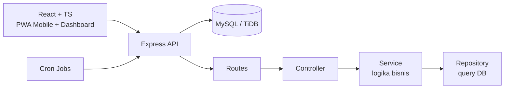
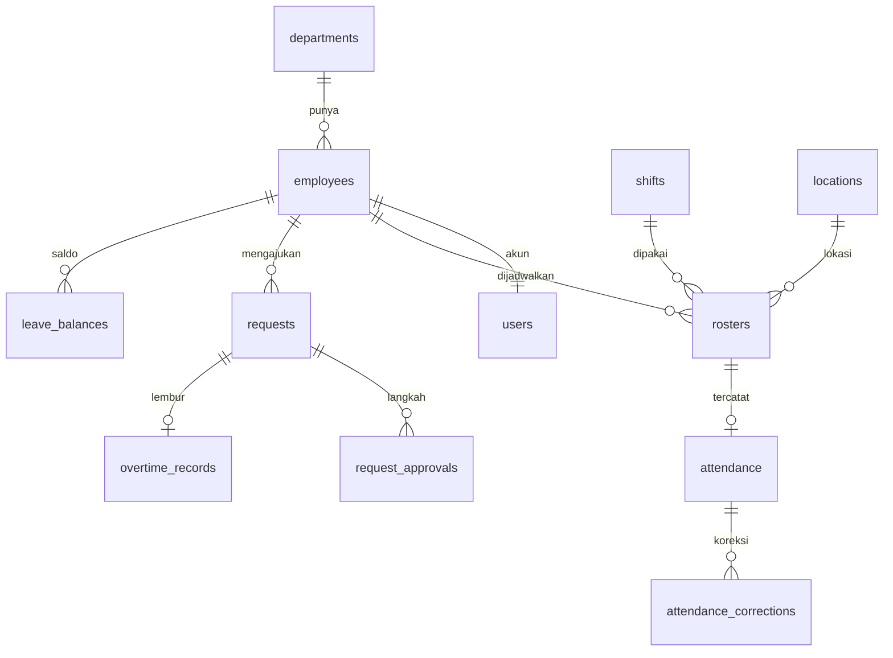
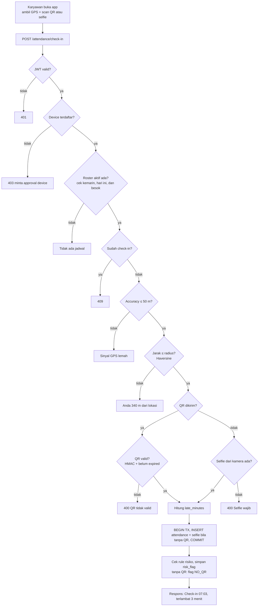
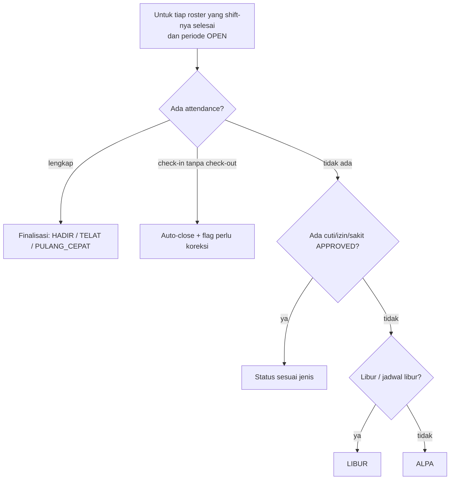
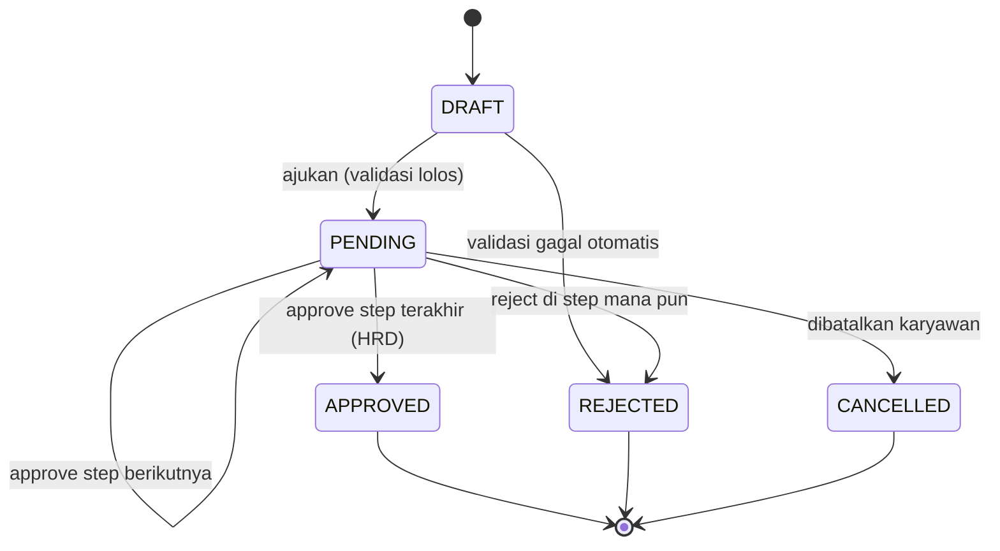
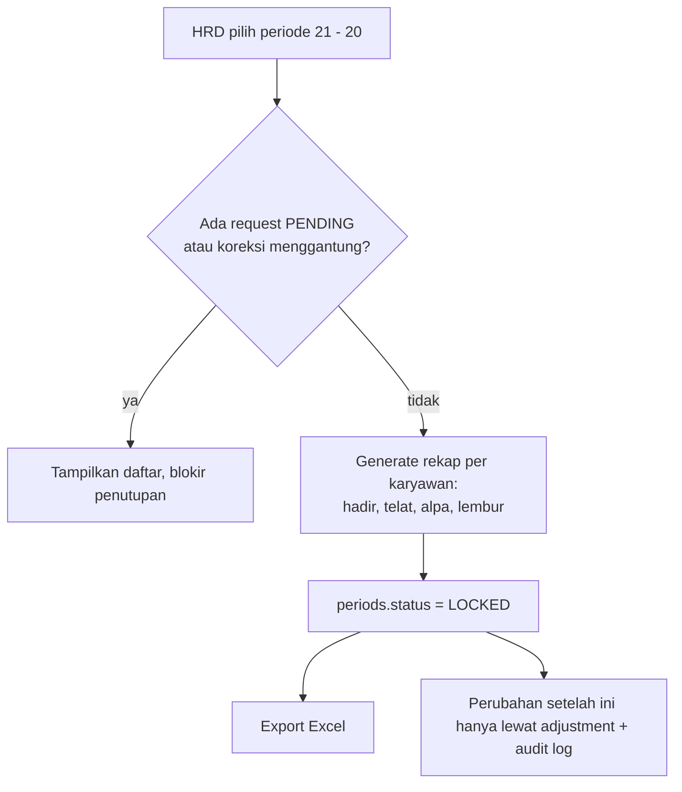

# Rancangan Sistem Absensi

> Dokumen acuan arsitektur, database, dan alur bisnis.
> Tampilan dan komponen UI ada di `design.md`.
> Semua data adalah **simulasi**. Angka aturan (toleransi, lembur, dll) adalah asumsi, bukan regulasi resmi.

**Stack:** React + TypeScript, Node.js + Express, MySQL (TiDB Cloud), JWT, Tailwind CSS

---

## 1. Tujuan dan Scope

**Tujuan:** sistem absensi pabrik yang punya logika bisnis nyata (shift, geofencing, approval, lembur, payroll-ready), bukan sekadar CRUD.

| Fase | Isi | Status |
|---|---|---|
| 1 | Master data, shift, roster, engine status harian + unit test | MVP |
| 2 | Check-in: geofencing, QR dinamis, device binding; absen tanpa QR dengan selfie (Fase 2b) | MVP |
| 3 | Workflow engine, cuti/izin, lembur | MVP |
| 4 | Cron alpa, tutup periode, export Excel | MVP |
| 5 | Dashboard, skor risiko, integrasi maintenance-system | Lanjutan |

**Di luar scope MVP (tulis jujur di README):**
- Notifikasi Telegram/email (cukup notifikasi in-app dulu)
- Eskalasi otomatis dan delegasi approver
- Skor risiko lanjutan
- Aplikasi native (cukup PWA)
- Perhitungan pajak/BPJS/gaji penuh (hanya rekap payroll-ready)

---

## 2. Keputusan dan Asumsi

| Hal | Nilai awal | Catatan |
|---|---|---|
| Toleransi telat | 5 menit | Simulasi, bisa diubah per shift |
| Akurasi GPS maksimal | 50 m | Di atas itu user diminta coba lagi |
| Radius geofence default | 100 m | Per lokasi |
| Masa berlaku QR dinamis | 45 detik | HMAC + expiry |
| Jendela check-in | mulai shift -2 jam sampai selesai +2 jam | |
| Jeda minimal antar shift | 11 jam | Validasi saat roster dibuat |
| Periode cut-off payroll | tanggal 21 sampai 20 | Konfigurasi di tabel `periods` |
| Lembur harian maksimal | 4 jam | Peringatan, bukan blokir |
| Kuota cuti tahunan | 12 hari | Per `leave_types` |
| Zona waktu | Asia/Jakarta (WIB) | Simpan UTC di DB, tampilkan WIB |
| Absen tanpa QR | Selalu tersedia, sejajar dengan scan QR | Untuk masuk dan pulang. Tanpa QR wajib selfie (bagian 7.1b) |
| Masa simpan selfie | 30 hari, lalu dihapus | Simulasi, atur sesuai kebijakan perusahaan dan UU PDP |
| Sampel tinjauan acak | 10% dari absen tanpa QR | Simulasi, di luar yang berflag risiko |

> Cek ulang angka di atas dengan aturan perusahaan/regulasi terbaru sebelum dipakai sungguhan.

---

## 3. Arsitektur



**Aturan utama:** semua logika bisnis ada di `service`, supaya mudah di-unit-test. Controller hanya menerima request dan mengembalikan respons.

---

## 4. Struktur Folder

```
attendance-system/
├── docs/
│   ├── alur.md
│   └── design.md
├── server/src/
│   ├── core/            # db, config, middleware (auth, rbac, error), audit
│   ├── modules/
│   │   ├── auth/        # login JWT, device binding
│   │   ├── employees/   # karyawan, divisi, atasan
│   │   ├── locations/   # titik lokasi + radius
│   │   ├── shifts/      # master shift, pola rotasi
│   │   ├── roster/      # jadwal harian (generate, tukar shift)
│   │   ├── attendance/  # check-in/out, status harian, koreksi
│   │   ├── workflow/    # engine approval (dipakai semua pengajuan)
│   │   ├── requests/    # cuti, izin, sakit, lembur, tukar shift
│   │   ├── overtime/    # hitung lembur
│   │   ├── payroll/     # periode, kunci, export Excel
│   │   └── dashboard/   # query analitik
│   ├── jobs/            # cron: daily-close, escalation
│   ├── utils/           # haversine.ts, shift-time.ts, hmac-qr.ts
│   └── tests/           # unit test (status, telat, lembur, shift malam)
├── client/src/
│   ├── features/        # mirror modules server
│   ├── components/ui/   # komponen dasar sesuai design.md
│   └── styles/          # tokens.css, tailwind config
└── database/            # migrations + seed simulasi
```

---

## 5. Database

### 5.1 Master

| Tabel | Kolom penting |
|---|---|
| `departments` | id, nama, kepala_id |
| `employees` | id, nik, nama, department_id, atasan_id, tanggal_masuk |
| `users` | id, employee_id, password_hash, role |
| `locations` | id, nama, lat, lng, radius_m |
| `shifts` | id, nama, jam_mulai, jam_selesai, lintas_hari, toleransi_menit |
| `shift_patterns` | id, nama, urutan (JSON, contoh: `["pagi","pagi","siang","siang","malam","malam","libur","libur"]`) |
| `holidays` | id, tanggal, nama |
| `leave_types` | id, nama, kuota_tahunan, butuh_lampiran |

### 5.2 Transaksi

| Tabel | Kolom penting |
|---|---|
| `rosters` | id, employee_id, **shift_date**, shift_id, location_id. **UNIQUE(employee_id, shift_date)** |
| `attendance` | id, roster_id (UNIQUE), check_in_at, check_out_at, lat_in, lng_in, lat_out, lng_out, distance_m, accuracy_m, late_minutes, status, **check_in_method**, **check_out_method** (`QR` / `NO_QR`), **review_status** (`NOT_REQUIRED` / `PENDING` / `SESUAI` / `MENCURIGAKAN`), **risk_flags** (teks kode dipisah koma, mis. `NO_QR`; kolom di `attendance`, bukan tabel), **reviewed_by** (users.id peninjau, tanpa FK), **reviewed_at** |
| `attendance_selfies` | id, attendance_id (FK ke `attendance`), jenis (`IN` / `OUT`), file_ref, captured_at, expires_at. **UNIQUE(attendance_id, jenis)**. Gambar tidak disimpan di tabel, melainkan di disk server (lihat catatan di bawah tabel) |
| `devices` | id, user_id, device_id, status (`active` / `pending`) |
| `requests` | id, type, employee_id, payload (JSON), status, current_step |
| `request_approvals` | id, request_id, step, approver_id, keputusan, catatan, waktu |
| `leave_balances` | id, employee_id, tahun, kuota, terpakai |
| `overtime_records` | id, request_id, jam_disetujui, jam_aktual, jam_dibayar, pengali |
| `attendance_corrections` | id, attendance_id, nilai_lama, nilai_baru, alasan, status |

**Catatan absen tanpa QR (migrasi 005-011, satu perubahan per file):** 005 `check_in_method` VARCHAR(10) NOT NULL DEFAULT `'QR'`; 006 `check_out_method` VARCHAR(10) NULL; 007 `review_status` VARCHAR(15) NOT NULL DEFAULT `'NOT_REQUIRED'`; 008 `risk_flags` VARCHAR(100) NULL; 009 `reviewed_by` BIGINT UNSIGNED NULL; 010 `reviewed_at` DATETIME NULL; 011 tabel `attendance_selfies`. Struktur ini sudah terbukti ada di TiDB (22 Okt 2026, `server/scripts/try-schema.ts`).

**Penyimpanan selfie:** file JPEG disimpan di disk server, folder `uploads/selfies` di folder tempat server dijalankan (dari `server/`: `server/uploads/selfies`; folder `uploads/` ada di `.gitignore`). Nama file = UUID acak + `.jpg` (tanpa NIK atau tanggal) dan itulah isi `file_ref`. Akses lewat antarmuka `SelfieStorage`, jadi bisa diganti object storage tanpa mengubah logika absen. Selfie dikirim klien sebagai base64 JPEG di dalam JSON (maksimal 300.000 byte setelah decode). Selfie yang lewat masa simpan (30 hari) dihapus oleh `server/scripts/purge-selfies.ts`.

**Catatan roster:** `"libur"` di `shift_patterns.urutan` adalah nama khusus (tidak peka huruf besar/kecil) dan **tidak membuat baris** di `rosters`. Nama lain dicocokkan ke `shifts.nama` (juga tidak peka huruf besar/kecil). Generate roster membatalkan seluruh proses bila ada jeda antar shift < 11 jam (aturan bisnis 4).

### 5.3 Sistem

`workflow_templates`, `workflow_steps` (template_id, urutan, role_approver, sla_jam), `periods` (start, end, status OPEN/LOCKED), `risk_flags`, `audit_logs`, `notifications`.

**Kunci desain:** tabel `requests` bersifat generik (kolom `type`), sehingga cuti, izin, sakit, lembur, tukar shift, dan koreksi absen memakai **satu workflow engine**.

### 5.4 Relasi inti



---

## 6. Role dan Akses

| Role | Hak |
|---|---|
| Karyawan | Absen, lihat jadwal dan rekap sendiri, ajukan request |
| Foreman | Approve step 1, lihat tim sendiri |
| SPV | Approve step 2, lihat divisi, atur roster |
| HRD | Approve final, kelola master, tutup periode, export |
| Admin | Semua, termasuk konfigurasi workflow |

---

## 7. Flow Utama

### 7.1 Check-in



**Rumus telat:** `late_minutes = max(0, now - (jam_mulai + toleransi))`

**Menentukan roster aktif:** ambil roster `shift_date` kemarin, hari ini, dan besok, pilih yang jendelanya `[mulai - 2 jam, selesai + 2 jam]` memuat waktu sekarang. Ini yang membuat shift malam lintas tengah malam tetap benar.

### 7.1b Absen tanpa QR dan tinjauan HRD

Beranda menyediakan dua jalur yang sejajar, untuk absen masuk dan pulang: **scan QR** (bila lokasi punya layar QR) dan **absen tanpa QR**. Alasannya praktis: tidak semua perusahaan memasang perangkat di tiap titik, dan antre scan menghambat.

- **Syarat tanpa QR:** akurasi GPS dan jarak geofence sama seperti jalur QR (bagian 2), perangkat sudah disetujui (device binding), dan **selfie diambil langsung dari kamera** (bukan memilih dari galeri). Selfie dikecilkan di HP sebelum dikirim.
- **Jam absen selalu jam server**, bukan jam HP. Status dan menit telat dihitung seperti biasa.
- **Absen tanpa QR langsung sah.** Karyawan tidak menunggu persetujuan. Setiap absen tanpa QR diberi flag `NO_QR` di `risk_flags`.
- **QR yang dikirim tetapi salah atau kedaluwarsa tetap ditolak** (aturan 9). Sistem tidak diam-diam pindah ke jalur tanpa QR; karyawan yang mau tanpa QR cukup tidak mengirim QR.
- **Tinjauan HRD berbasis pengecualian.** Antreannya berisi absen berflag risiko ditambah sampel acak (bagian 2). `review_status` bernilai `NOT_REQUIRED` (lewat QR atau tidak terpilih), `PENDING`, `SESUAI`, atau `MENCURIGAKAN`. **Hasil tinjauan tidak mengubah jam absen.** Tindak lanjut lewat pengajuan koreksi dan audit log (aturan 10).
- **Periode tidak bisa dikunci** selama masih ada absen berstatus tinjauan `PENDING` (usulan, belum final).
- **Privasi selfie:** hanya diambil saat absen tanpa QR, hanya bisa dilihat HRD dan Admin, dihapus setelah masa simpan (bagian 2), dan **tanpa pencocokan wajah otomatis** (data biometrik, UU PDP).
- **Keterbatasan jujur:** jalur tanpa QR lebih mudah dicurangi daripada jalur QR. Selfie bisa difoto dari layar, dan di laptop kamera bisa diganti kamera virtual. Selfie dan tinjauan berfungsi sebagai pencegah dan bukti, bukan jaminan. Rule berbasis pola (lokasi melompat jauh dalam waktu singkat, koordinat dan akurasi identik berulang) menunggu Fase 5.

### 7.2 Penutupan Harian (cron, tiap malam)



**Status harian satu roster** (`utils/daily-status.ts`, pure, dipakai check-in/out dan cron):
- Telat = check-in setelah jam mulai + toleransi shift. **Pulang cepat** = check-out sebelum jam selesai - toleransi shift yang sama. Menit dibulatkan ke bawah.
- Prioritas status saat hadir: `TELAT` > `PULANG_CEPAT` > `HADIR`. Menit telat dan menit pulang cepat tetap dilaporkan terpisah.
- Belum final selama shift belum selesai (`now < selesai`). Check-in tanpa check-out setelah selesai: status dari check-in + flag perlu koreksi.
- Tanpa attendance setelah selesai: cuti/izin/sakit APPROVED, lalu libur nasional (`LIBUR`), selain itu `ALPA`. Kehadiran nyata selalu menang atas cuti/izin/sakit.

**Check-out dan batas waktu** (`POST /attendance/check-out`):
- Yang dicari adalah absen terakhir karyawan (`check_in_at` terbaru), bukan lewat jendela roster, supaya shift malam tetap menempel ke tanggal mulainya.
- Batas akhir check-out = jam selesai shift + `RULES.checkinWindowHoursAfter` (2 jam). Tepat di batas masih boleh.
- Absen yang punya check-in tanpa check-out dan sudah lewat batas ditutup otomatis (cron tiap 15 menit, hanya jika `RUN_JOBS=true`): `auto_closed=1` dan `needs_correction=1`. `check_out_at` dibiarkan kosong karena jam pulang tidak boleh dikarang. Koreksinya lewat pengajuan ke HRD (Fase 3). Proses ini idempoten dan tercatat di audit log.
- **Alasan pulang awal:** check-out sebelum jam selesai shift persis (`isBeforeShiftEnd`, sama dengan `checkOut.early` di `/attendance/today`) wajib menyertakan `earlyLeaveReason` (dropdown 5 kode, tanpa teks bebas). Jam server yang menentukan, bukan client. Diperiksa setelah GPS dan QR. Sudah jam selesai atau lewat: alasan diabaikan. Disimpan di `attendance.early_leave_reason` (nullable). Alasan tidak mengubah status; PULANG_CEPAT tetap selesai dikurangi toleransi, jadi pulang di rentang toleransi wajib alasan tetapi status `HADIR`. `SAKIT_KECELAKAAN` hanya disimpan, **bukan sistem tanggap darurat**.
- **Lembur** tidak dihitung otomatis dari belum check-out. Sistem tidak mengisi check-out otomatis di jam selesai (jam pulang tidak boleh dikarang); absen yang lupa check-out ditutup otomatis dan dikoreksi lewat HRD.
- Penutupan harian untuk status ALPA, LIBUR, dan cuti (`jobs/daily-close.ts`) tetap di Fase 4.

**Status Beranda** (`GET /attendance/today`, `utils/today-state.ts`, pure): memakai jendela roster yang sama dengan check-in dan batas yang sama dengan check-out. Hanya membaca. Detail status dan prioritas ada di `docs/api.md`.

### 7.3 Workflow Approval (contoh: cuti)



**Validasi saat pengajuan cuti:**
1. Saldo cukup?
2. Tanggal tidak bentrok dengan roster yang sudah ada pengajuan lain?
3. Kuota cuti divisi per hari belum terlewati?

**Saat APPROVED:** potong `leave_balances` dan tandai roster pada tanggal tersebut sebagai CUTI.

Urutan approver: Foreman, SPV, HRD. Urutan ini diambil dari `workflow_steps`, **bukan hardcode**.

### 7.4 Lembur

1. Karyawan mengajukan lembur (tanggal, jam rencana), masuk workflow approval.
2. Dikerjakan, karyawan absen seperti biasa.
3. Saat shift ditutup: `jam_dibayar = irisan(jam_disetujui, jam_absen_aktual)`.
4. Kalikan dengan pengali dari tabel aturan (hari kerja vs libur).
5. Beri peringatan jika melebihi batas harian atau mingguan.

### 7.5 Penutupan Periode dan Payroll



Generate rekap harus **idempotent**: dijalankan dua kali menghasilkan hasil yang sama.

---

## 8. Aturan Bisnis (wajib di-unit-test)

1. Shift malam 22:00-06:00 dihitung ke `shift_date` hari mulainya.
2. Telat dihitung dari jam mulai + toleransi, bukan jam mulai.
3. Satu roster hanya boleh satu check-in (unique constraint).
4. Jeda minimal antar shift ≥ 11 jam saat roster dibuat.
5. Lembur dibayar hanya pada irisan jam disetujui dan jam terbukti.
6. Cuti ditolak otomatis jika saldo tidak cukup.
7. Periode LOCKED tidak bisa diubah langsung.
8. Check-in di luar jendela waktu ditolak.
9. QR yang sudah expired atau tanda tangannya salah ditolak.
10. Koreksi absen tidak mengubah data langsung, hanya lewat pengajuan dan tercatat di audit log.
11. Absen tanpa QR wajib menyertakan selfie langsung dari kamera, dan jam absennya selalu jam server.
12. QR yang dikirim tetapi tidak valid ditolak; tidak otomatis dialihkan ke jalur tanpa QR.
13. Hasil tinjauan HRD tidak mengubah jam absen; perubahan hanya lewat pengajuan koreksi dan tercatat di audit log.
14. Periode tidak bisa dikunci selama masih ada absen dengan tinjauan `PENDING` (usulan).

---

## 9. Kualitas Teknis

- Transaksi database dan unique constraint untuk mencegah double submit.
- Validasi di backend (jangan percaya frontend), termasuk jarak geofence.
- RBAC di middleware, bukan hanya menyembunyikan menu.
- Audit log untuk semua aksi sensitif (koreksi, tutup periode, ganti device, ubah master).
- Seed data simulasi realistis (50 karyawan, 5 divisi, roster 12 bulan ke belakang + 30 hari ke depan, absen historis), dilabeli "data simulasi". Rentang 12 bulan dipilih supaya grafik tahunan dashboard punya 12 titik per divisi.
  - Absen historis dibuat oleh `utils/seed-attendance.ts` (pure, deterministik per `NIK|tanggal`). Status **tidak ditulis tangan**: jam check-in/out dibuat, lalu status dan menit telat dihitung `computeDailyStatus`.
  - Status yang diisi: `HADIR`, `TELAT`, `PULANG_CEPAT`, `ALPA`, dan `LIBUR` (hari libur nasional, tanpa jam). `CUTI/IZIN/SAKIT` tidak diisi karena harus berasal dari pengajuan APPROVED (Fase 3).
  - Profil telat dasar per divisi: Gudang 16%, Produksi 10%, Maintenance 7%, Quality Control 4%, HR 2,5%; Senin 1,4x; ~8% karyawan telat kronis. Hanya roster yang shift-nya sudah selesai yang diberi absen.
  - Query dashboard: baris `LIBUR` harus dikeluarkan dari penyebut tingkat kehadiran/telat.
  - Hari libur di tabel `holidays` (termasuk cuti bersama, ditandai di nama) diverifikasi dari SKB 3 Menteri 2025/2026.
- Privasi: lokasi hanya diambil **saat absen**, tidak dilacak terus-menerus. Selfie hanya diambil saat absen tanpa QR (bagian 7.1b).
- Keterbatasan jujur: aplikasi web tidak bisa mendeteksi fake GPS, maka dilapisi QR dinamis, device binding, dan flag risiko. Jalur absen tanpa QR (7.1b) lebih mudah dicurangi daripada jalur QR; selfie dan tinjauan HRD berfungsi sebagai pencegah dan bukti, bukan jaminan.

---

## 10. Urutan Pengerjaan

1. **Fondasi:** skema DB, seed, employees, shifts, roster, fungsi hitung status harian + unit test.
2. **Check-in:** geofencing, QR dinamis, device binding, lalu absen tanpa QR dengan selfie (Fase 2b).
3. **Workflow engine** untuk cuti/izin, lalu lembur.
4. **Cron dan rekap:** alpa otomatis, penguncian periode, export Excel.
5. **Dashboard** dan skor risiko (termasuk rule pola: lokasi melompat, koordinat identik berulang).
6. **Integrasi** maintenance-system (satu login, mekanik cuti tidak bisa ditugaskan), deploy, README dengan screenshot.

---

## 11. Checklist Sebelum Mulai Coding

- [ ] Asumsi di bagian 2 sudah dikonfirmasi
- [ ] `design.md` dibaca dan token dipasang dulu di Tailwind
- [ ] Repo dibuat, dokumen ini di-commit sebagai commit pertama
- [ ] Skema DDL fase 1 ditulis dan di-review
- [ ] Unit test untuk aturan bisnis 1-3 ditulis sebelum implementasinya
